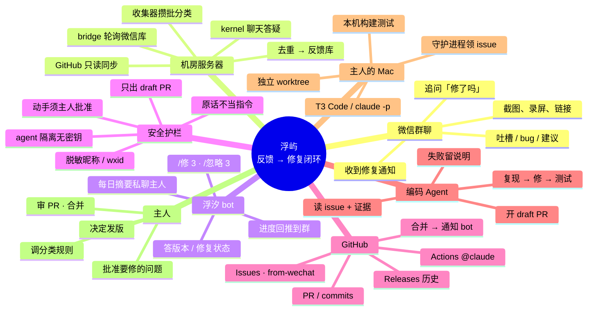

# 群反馈闭环设计（浮屿）

> 整理自 2026-11-24 的讨论。目标：浮汐自动整理浮屿用户群里的反馈，对照浮屿仓库的版本历史、issue、PR，
> 经主人批准后交给编码 agent 修复，修好再回到群里告诉反馈人。

## 一、起因：bot 读不懂别人发的链接

现象：给 bot 发链接，它说看不到网页内容。

排查结论：**不是缺 MCP，是正文抽取太粗**。

- 链路是通的：桥接解析分享卡片时会带上 URL（`bridge/fuxi_bridge/messages.py` 的 `parse_appmsg`），
  内核 `kernel/src/adapters/links.js` 负责抓取，配置 `links.enabled: true`。
  线上日志两次都是 `读取链接：host=github.com → ok`。
- 抽取规则只取页面的 og 标题/简介，加上前几个 `
` 段落，再截 600 字放进提示词。
  GitHub 仓库页抽到的「正文」全是顶部导航（Sign in Products Platform …），README 一个字没有。
- 提示词要求「只有标题或摘要时不当作完整内容」（`kernel/src/persona/prompt.js` 的 `linkBlock`），
  所以 bot 如实说读不到。

不用 MCP 的理由：内核是「先备好资料塞进提示词、再调用一次模型」，不是会调用工具的 agent。
接 MCP 要改成多轮工具调用，每条消息都更慢、更费 token，还要大改上游；底层仍是「抓 HTML、抽正文」。

改进（F0，已完成）：`kernel/fuxi/links.js` 由 `preload.js` 安装，替换上游 `links` 模块导出的
`describeLink` / `formatForPrompt`（内核按 `links.xxx` 调用，所以不用改上游文件）：

1. 普通网页：仍用上游 `fetchUrl`（只读公网、防 DNS 重绑定、大小和总时长限制），正文改用 Readability
   在可终止线程里抽取并保留段落；认不出正文时退回上游抽法。
2. GitHub issue / PR / release：走公开 API，拿标题、状态（未关闭 / 已合并 / 已解决）、标签和正文。
   仓库首页 Readability 已能抽出 README，不另走 API。未登录 API 每小时 60 次，超了自动退回读网页。
3. 短视频、笔记（B 站、抖音、小红书）：交回上游原逻辑，只读标题和文案。B 站接口取完整简介/字幕暂未做。
4. 读不到时给出中文原因（404、拒绝访问、不是网页、超时、要登录等），让 bot 能如实说明。
5. 上限：上游 `persona/prompt.js` 的 `linkBlock` 会把整段截到 1200 字，所以输出控制在约 1150 字，
   正文被截断时注明「只是开头一段，不是全文」。要再放宽只能改上游一行，暂不做。

没做：第三方阅读服务（如 Jina Reader，链接会经过第三方）；小红书、抖音等要跑 JS 的页面（要无头浏览器，太重）；
GBK 编码的老网页（上游按 UTF-8 解码，会乱码）。

## 二、已定事项

| 事项 | 决定 |
|---|---|
| 浮屿仓库 | [TixXin/Fuyu](https://github.com/TixXin/Fuyu)，**公开**，默认分支 `main`；版本说明在仓库 `docs/releases/v<版本>.md`（中英双语，「## 更新内容」段）。公开仓库，所以 issue 必须脱敏 |
| 反馈来源 | 只收集一个群：浮屿用户群（具体 chat_id 写进 `settings.json`） |
| 修复在哪跑 | 默认云端 GitHub Action（`@claude`）；需要本机构建测试的问题由 Mac 本地跑 |
| 人工关卡 | 开 issue 前要主人批准；PR 只出 draft，合并和发版由主人决定 |

## 三、全景

## 四、完整流程

★ 表示需要主人点头的关卡。

| # | 在哪 | 做什么 | 阶段 |
|---|---|---|---|
| 1 | 群聊 | 群友报 bug、提建议，附截图或录屏 | F1 |
| 2 | 服务器 bridge | 读到指定群的消息（不管有没有 @ bot），转给反馈收集器 | F1 |
| 3 | 服务器 收集器 | 每小时攒一批交给 DeepSeek：分成 bug / 建议 / 提问 / 无关，同一问题合并，记下提出人、原话、图片描述 | F1 |
| 4 | 服务器 ↔ GitHub | 和同步下来的 issue、release、PR 对比，标出「已知」「已修于 vX」「新问题」 | F2 |
| 5 | bot → 主人 | 每天私聊一份摘要，每条带编号；群里有人问进度时 bot 直接答 | F1 |
| 6 ★ | 主人 | 微信回 `/修 3` 批准，或 `/忽略 3` | F3 |
| 7 | 服务器 → GitHub | 去掉昵称、wxid 后开 issue，打 `from-wechat` 标签；群友原话只作为问题描述 | F3 |
| 8 | Agent | 云端 Action 或 Mac 守护进程领 issue，在隔离 worktree 里复现、修改、跑测试 | F3 |
| 9 | Agent → GitHub | 开 draft PR 关联 issue；修不了就在 issue 里写清卡在哪 | F3 |
| 10 ★ | 主人 | 审 PR、合并、决定什么时候发版。不自动合并，不自动发版 | — |
| 11 | GitHub → bot → 群 | 合并或发版后通知 bot，bot 在群里告诉原反馈人「v1.4.3 已修复」 | F2 |

## 五、各部分设计要点

### 反馈收集器（bridge 内，F1）

- 不走内核的聊天回复流程：群里多数消息不 @ bot，且一个问题常要好几条消息说清楚。
- 指定群的消息先进缓冲（含图片描述、语音转文字），每小时或攒够一批再分类；每天固定时间出摘要。
- 反馈库存 `/state/feedback.json`（或 SQLite）：编号、类别、摘要、原话片段、提出人（内部存 wxid，对外不暴露）、
  首次/最近出现时间、提到次数、状态（新 / 已知 / 已开 issue / 已修 / 忽略）、关联 issue 号。
- 开关和参数放 `settings.json`：反馈群、分类频率、摘要时间。

### GitHub 同步（服务器，F2）

- 只读的细粒度 token，只授权浮屿仓库：Releases、Issues、PR、最近 commits，定时增量同步到本地缓存。
- 用途：新反馈查重；bot 回答「修了没 / 哪个版本」；摘要里标注已知问题。
- 机房访问 GitHub 慢，走代理（见 `jifang-github-access` 的做法）。
- 合并/发版事件：先用定时轮询，不对公网开 webhook（与「对外 API 不暴露公网」一致）。

### 开 issue（F3）

- 只在主人 `/修 N` 后开。开 issue 需要另一个有写权限的 token，与只读 token 分开。
- issue 正文：问题描述（模型整理）、复现线索、出现次数、版本号（如果群友提到）；不带昵称、wxid、聊天截图原图。
- 截图如果有用，先人工确认不含隐私再附。

### 编码 agent（F3）

- **云端（默认）**：浮屿仓库装 Claude Code GitHub Action，issue 带 `from-wechat` 且由主人触发时运行，产出 draft PR。
- **Mac 本地（可选）**：守护进程轮询带 `fix-local` 标签的 issue，起 T3 Code 或 `claude -p` 会话，
  在独立 worktree 里修，开 draft PR。用于必须在 macOS 上构建或测试的问题。
- 不做图形界面自动化（模拟点击开会话），太脆弱。

### 安全护栏

- **提示注入**：群友的话会进入能改代码的 agent。原话只作为 issue 里的「问题描述」，agent 的指令模板固定；
  agent 环境拿不到 `.env`、部署密钥；只能开 draft PR。
- **人工关卡**：开 issue、合并、发版三处都要主人。
- **隐私**：公开仓库的 issue 不出现群友身份信息和原始截图。
- **噪声**：F1 先只出摘要，跑一两周看分类准确度，再接自动开 issue。

## 六、分阶段

| 阶段 | 内容 | 依赖 |
|---|---|---|
| F0 | 链接读取改进（第一节）✅ | 无 |
| F1 | ✅ 收集器 + 反馈库 + 每日 12:00 私聊主人摘要 + 20:00 群小结 | — |
| F2 | ✅ 同步、查进度、通知主人已上线；群里答进度、回群通知待接 · GitHub 只读同步（缓存放 `/state/fuyu/`：`releases.json`、`issues.json`、`prs.json`、`meta.json`，字段沿用 GitHub API）、查重、bot 答进度、修复后回群通知 | 机房代理；公开仓库可先不用 token（每小时 60 次） |
| F3 | `/修 N` 开 issue、云端 Action 出 draft PR、Mac 本地守护进程（可选） | 写 token、仓库装 Action |

## 七、待补

与「用户群产品助手」的分工：它的知识文件放 `/state/knowledge/`，版本信息读 F2 的 `/state/fuyu/releases.json`。

已定：反馈群为浮屿用户交流群（`58017233233@chatroom`）；每天 12:00 私聊主人（主人微信号，不是 bot 号的文件传输助手）发摘要，
20:00 在群里发当天反馈小结（不带人名和 issue 编号，只写标题和处理状态）。
